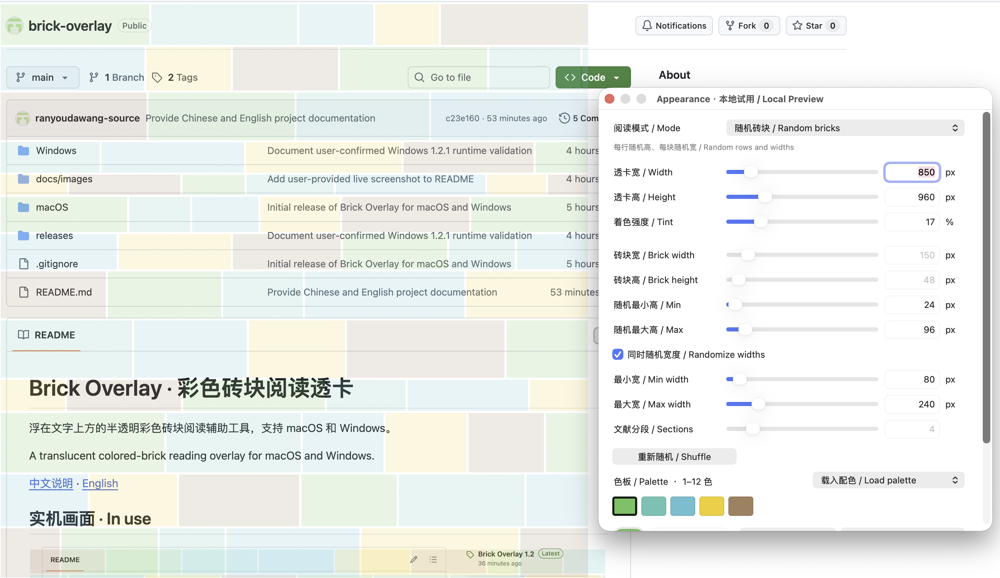

# Brick Overlay · 彩色砖块阅读透卡

浮在文字上方的半透明彩色砖块阅读辅助工具，支持 macOS 和 Windows。

A translucent colored-brick reading overlay for macOS and Windows.

[中文说明](#中文说明) · [English](#english)

## 实机画面 · In use

用户提供的新版功能实机演示：绿色配色、随机砖块宽度，以及 Appearance 中的尺寸、随机范围和色板设置。截图拍摄于本地试用阶段，正式版已去掉“本地试用”字样；当前下载与功能以本说明为准。

A user-provided demonstration of the new features: the green palette, random brick widths, and dimensions, random ranges and palette controls in Appearance. Captured during local preview testing; the official release no longer displays the Local Preview label. See below for current downloads and features.

## 中文说明

### 下载

**[1.3.0 正式版发布页](https://github.com/ranyoudawang-source/brick-overlay/releases/tag/v1.3.0)**

- [macOS 1.3.0（Apple Silicon）](https://github.com/ranyoudawang-source/brick-overlay/releases/download/v1.3.0/BrickOverlay-macOS.zip)
- [Windows 1.3.0](https://github.com/ranyoudawang-source/brick-overlay/releases/download/v1.3.0/BrickOverlay-Windows.zip)

### 功能

- 透卡默认鼠标穿透；右侧 `⋯` 按钮打开菜单，解锁后可拖动。菜单栏或通知区域保留退出入口。
- **Appearance** 支持滑块和数值输入：透卡宽 100–6000、高 48–4000；砖块宽 24–1200、高 8–1000。
- **砖块**：固定宽高、交错排列。
- **随机砖块**：指定最小、最大高度；勾选“同时随机宽度”后，每行随机高度、行内每块随机宽度。边缘砖块裁切，重绘和改色不打乱布局，可点击“重新随机”。
- **文献阅读**：2–16 个整宽大色块，适合英文长段落；按区域划分，不自动识别正文段落。
- **自选色板**：1–12 色，系统选色器、`#RRGGBB` 输入、添加和删除；五组内置配色。“绿色”恢复旧版 Mac 色系，Windows 使用其浅色外观下的色值。
- 保存启动默认外观和命名个人预设，包含尺寸、模式、随机范围、布局和颜色。

尺寸以屏幕坐标单位计：macOS 为逻辑点，Windows 受显示缩放影响，不一定等于物理像素。允许透卡超出屏幕；菜单按钮尽量保持可见。

### 使用与升级

先退出旧版或试用版，避免多张透卡叠加。

**macOS**：解压并打开 `BrickOverlay.app`。预编译包要求 Apple Silicon + macOS 26。应用使用本地临时签名，未做开发者签名或公证。右侧菜单及菜单栏“透”均可退出。

**Windows**：面向 Windows 10/11 + .NET Framework 4.8。将整个压缩包解压到可写文件夹，双击 `BrickOverlay.exe`。备用入口为 `Start Brick Overlay.cmd`；可用 Windows PowerShell 从配套源码重新编译。请保留源码和启动脚本。

首次启动 1.3 时，优先导入本机试用版设置；没有试用版设置则读取旧正式版。后续使用正式版独立保存的数据。Mac 使用 `local.codex.brickoverlay` 偏好域中的 `state`，Windows 使用 `%APPDATA%\BrickOverlay\settings-v1.3.xml`，原 `settings.xml` 保留。

已有自选颜色不会自动覆盖。要使用恢复后的绿色，请在 **Appearance → 载入配色 → 绿色** 重新载入，满意后保存为默认或个人预设。

### 验证与反馈

用户已确认 1.3 的尺寸输入、随机布局、自选颜色和文献模式试用版在 Mac 与 Windows 可用，并确认 Mac 恢复后的绿色可用。正式包已完成两平台编译、布局与预设保存测试、Mac 签名和压缩包检查。Windows 最后的绿色色值调整与正式版设置迁移尚未单独在 Windows 桌面复测。

通过 [Issues](https://github.com/ranyoudawang-source/brick-overlay/issues) 提交系统版本、复现步骤和报错信息。Appearance 主要使用中英双语；部分菜单和预设名称仍为中文。

## English

### Downloads

**[Version 1.3.0 release](https://github.com/ranyoudawang-source/brick-overlay/releases/tag/v1.3.0)**

- [macOS 1.3.0 (Apple Silicon)](https://github.com/ranyoudawang-source/brick-overlay/releases/download/v1.3.0/BrickOverlay-macOS.zip)
- [Windows 1.3.0](https://github.com/ranyoudawang-source/brick-overlay/releases/download/v1.3.0/BrickOverlay-Windows.zip)

### Features

- Click-through overlay, a menu button on its right, and an unlock option for dragging. Menu-bar or notification-area controls include Quit.
- **Appearance** offers sliders and numeric input: overlay width 100–6000 and height 48–4000; brick width 24–1200 and height 8–1000.
- **Bricks**: uniform sizes in staggered rows.
- **Random bricks**: configurable height range. Enable **Randomize widths** for random row heights and individual brick widths. Edge bricks are clipped. Repainting or changing colors keeps the layout stable; Shuffle generates another layout.
- **Document**: 2–16 full-width reading bands for longer passages. This divides the area geometrically, without paragraph detection.
- **Custom palette**: 1–12 editable colors, native color picker, hex input, add/remove controls and five presets. The green preset restores the original Mac colors; Windows uses their light-appearance sRGB values.
- Startup defaults and named presets save dimensions, mode, random ranges, layout and colors.

Dimensions use screen coordinates: logical points on macOS and display-scaled units on Windows, which may differ from physical pixels. Oversized overlays are allowed, with the menu button kept visible where possible.

### Use and upgrade

Quit the previous stable or preview app before launching this version.

**macOS**: extract and open `BrickOverlay.app`. The prebuilt app requires Apple Silicon and macOS 26. It is ad-hoc signed, not Developer ID signed or notarized. Use the right-side menu or the **透** menu-bar item to quit.

**Windows**: intended for Windows 10/11 with .NET Framework 4.8. Extract the entire archive into a writable folder, then open `BrickOverlay.exe`. The fallback `Start Brick Overlay.cmd` can rebuild from the included source using Windows PowerShell. Keep the source and launcher files together.

On first launch, 1.3 imports preview settings when available, otherwise the previous stable settings. Subsequent runs use the saved 1.3 state. macOS stores `state` in the `local.codex.brickoverlay` preferences domain. Windows uses `%APPDATA%\BrickOverlay\settings-v1.3.xml`, preserving the old `settings.xml`.

Existing custom colors are preserved. To load the restored green palette, choose **Appearance → Load palette → 绿色**, then save it as your default or a named preset if desired.

### Testing and feedback

The user confirmed the 1.3 preview features working on both Mac and Windows, and the restored Mac green palette working on Mac. Release checks include compilation for both platforms, layout and preset persistence tests, Mac signature verification and archive integrity. The final Windows palette values and stable settings migration have not yet received a separate Windows desktop retest.

Please report your operating system version, reproduction steps and error details in [Issues](https://github.com/ranyoudawang-source/brick-overlay/issues). Appearance uses mostly bilingual labels; some menus and palette names remain Chinese.

## 项目文件 · Project files

- `macOS/Appearance.swift` — 布局与数据 / Layout and data model
- `macOS/Overlay.swift` — AppKit 界面 / AppKit interface
- `macOS/Info.plist`, `macOS/build.sh` — 元数据与编译 / Metadata and build script
- `Windows/BrickOverlay.cs` — WinForms 源码 / WinForms source
- `Windows/Start.ps1`, `Windows/Start Brick Overlay.cmd` — 备用编译启动 / Fallback build and launch
- `releases/` — 两平台安装包 / Both platform archives
- `docs/images/brick-overlay-live.png` — 实机截图 / Screenshot
